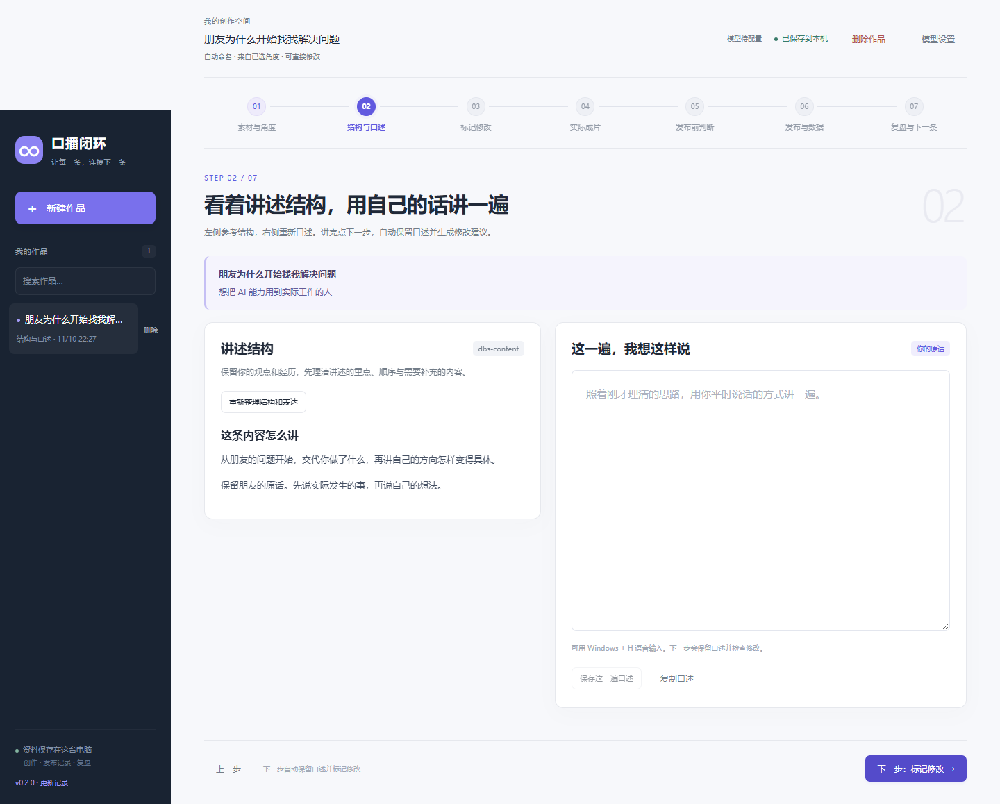

# 口播闭环工作台

把真实想法做成口播，分别留下两份发布前判断，再把数据和评论变成下一条可以试用的观察。

一个面向口播创作者的 **Windows 本地工作台**。从素材、角度、结构与口述，到修改、成片确认、发布登记和复盘，在同一条作品里保留完整过程。使用原生 HTML / CSS / JavaScript 和 Python 标准库，运行时无需安装 pip 或 npm 依赖。

当前版本 **0.2.0**。完整迭代记录见 [CHANGELOG.md](CHANGELOG.md)，页面左下角也可打开“更新记录”。版本号统一读取 `VERSION`。



截图来自隔离测试资料与模拟模型。

## 主要功能

- **从素材走到口播**：找讲述角度、准备标题封面和开头，在结构旁重新口述，逐项接受修改建议。
- **保留创作过程**：输入自动保存，口述、建议、合并正文与最终内容分别留版，多窗口编辑时提示冲突。
- **两份发布前判断**：内容价值判断与内容作弊预测分别请求、分别审阅和锁定，保留对应成片快照。
- **把复盘带到下一条**：手动登记发布时间、同一窗口的数据与评论，生成观察并选一项用于新作品。
- **多个模型配置**：支持 OpenAI 兼容 Chat Completions 和 Responses 接口，可保存和切换配置，API Key 由 Windows 当前用户加密保存。

## 开始使用

### 下载项目

安装 [Python 3.10 或更新版本](https://www.python.org/downloads/)，在安装时勾选添加到 `PATH`。在终端运行 `python --version` 确认环境。

可以点击仓库页面的 **Code → Download ZIP**，解压后进入包含本 README 和 `server.py` 的文件夹；也可以使用 Git：

```powershell
git clone https://github.com/william854014048-ops/creator-loop-workbench.git
cd creator-loop-workbench
python -B server.py --open
```

### 启动和停止

需要 Windows 和 Python 3.10 及以上。双击本文件夹的 **启动口播闭环.cmd**，浏览器会打开 **http://127.0.0.1:8780/**。首次启动是空作品库，点击「新建作品」即可写下素材，输入自动保存。

本程序的代码、方法和资料独立保存在这个文件夹。服务器只监听本机，运行无需安装 pip 或 npm 依赖。也可以在本文件夹运行 `python -B server.py --open`，保持终端运行；按 Ctrl+C 停止。双击启动入口会在后台启动服务，再次双击会复用已运行的服务。

### 配置模型

右上角打开「模型设置」，点击「新增配置」，填写一个方便识别的名称，再选服务方式、地址、模型名和 API Key。支持 DeepSeek / OpenAI 兼容 Chat Completions，以及 GPT Responses。同一种接口也可以保存多个配置，每个配置单独保存密钥。选择已保存的配置，点击「保存并使用」切换。服务地址填写根地址，例如 `https://api.deepseek.com/v1` 或 `https://api.openai.com/v1`，由程序添加请求路径。

API Key 按当前 Windows 用户加密保存，页面只显示是否已配置。「测试连接」发送一次短请求，使用单独的小额度；点击「保存并使用」才保存表单和切换。更换电脑或 Windows 用户需要重新填写密钥。写稿、保存、看历史可离线进行。点击 AI 操作，或通过“下一步”启动找角度、整理结构和标记修改时，会向所配置的服务发送该步需要的文字，费用按服务商规则计算。回看已有对应结果时直接复用。

单次输出上限默认 32768 token，包含模型思考与正文。遇到达到输出限制，可在该配置中提高上限，或手动降低推理强度后重试；输入与旧结果会保留。模型请求最长等待 240 秒。旧版的两个接口配置会自动读成独立命名配置，首次保存前保留原加密设置备份。

诊断日志在 `runtime/model-diagnostics.jsonl`，记录模型、任务、用量、结束原因与耗时，排除密钥、原文、正文和思考内容。单文件最多约 2 MB，保留一个轮转备份。作品判断中的请求编号可与日志对应。

## 跑通第一条

1. **素材与角度**：写下灵感、经历和想表达的话，点击「找讲述角度」，选定一个方向。保存该方向对应的标题、封面文字和开头候选。
2. **结构与口述**：选定角度后点下一步，自动用 `dbs-content` 整理表达结构。桌面左侧显示结构，右侧用自己的话再讲一遍，可用 Windows + H 语音输入或粘贴转写稿。原第二、第三步合并在这里。
3. **标记修改**：口述完成点下一步，直接保留这一遍并用 `dbs-script-flow` 生成修改建议。逐项勾选或“全选修改”，点击“接受所选，合并全文”得到干净稿。“全不选”可恢复保留原话。选择在当前窗口暂存，刷新可接回。
4. **实际成片**：在原来的工具中拍摄和剪辑，回到这里校对真正采用的正文、标题、封面、开头、平台和账号，再确认。
5. **发布前判断**：分别运行并审阅 `dbs-content-value` 和 `cheat-predict`，分别确认锁定。两项可以单独重试，每版结果都会保留。
6. **发布与数据**：在平台手动发布后登记时间，选择统一的 24 小时、72 小时或 7 天窗口。到时手动填写播放、赞、评论、分享、收藏和代表评论，保存这次观察。
7. **复盘与下一条**：让 `cheat-retro` 对照两个发布前结果与同一次数据。选一项相关观察「用于下一条」，在新作品中写清本次准备怎样应用。

### 作品名称与删除

名称可在页面顶部直接修改。自动命名依次采用已选角度、成片标题、素材首句、口述首句和正文首句。空作品以新建时间与短编号区分，顶部会说明当前名称来源。手动名称优先，清空名称后恢复自动命名，已有“未命名作品”也按此规则展示。

作品列表每条右侧和当前作品顶部均有删除按钮。确认后从列表移除，本机文件保留删除标记、原文和历史，相关锁定快照继续保留。多窗口版本冲突时需要先核对当前版本。

### 发布前两份结果怎样运行

**内容价值判断**采用 `dbs-content-value`，评估开头、哪些人会看、互动倾向和商业价值，按该方法保留内容侧判断。

**内容作弊盲预测**采用 `cheat-predict` 的应用适配：先独立请求盲评分，再用另一个全新请求写预测，保存评分、概率分布、中枢、锚点缺失说明、不同结果的解释与关键假设。采用观点口播的 v0 等权零基准规则。

首版固定显示 **0 基准／无个人历史样本**。即使已经积累了几次复盘，也不会自动把这些资料带进判断。两个方法各自只收到当前最终稿、标题、封面文字、开头、平台、时长和对应规则；不带创作对话、旧稿、另一份结果、账号历史或实绩评论。内容作弊内部的评分请求同样独立。

记录使用模型 API 的无会话请求。这里没有调用其他桌面 Agent 的登录或读取其聊天。原版方法和应用的输入输出约定分别保存，可查看 `skills/source-manifest.json` 的来源及校验值；原版文件保持原样。

确认锁定后，程序将判断与当时最终稿单独存档。改动成片后，旧判断继续保留并标记对应旧版；发布登记之后，该作品的发布前判断入口关闭。复盘会对照发布登记时引用的原始结果。

### 数据和评论

- 数字空着表示未知，填写 0 会保存为真实的 0。
- 评论每行一条，可写「12 | 评论正文」，也可只写正文。暂时取不到评论时，填写原因后再复盘。
- 保存实际发布时间和观察时间。提前或明显超过预定窗口的记录会单独标记，实际数据仍可保留与复盘。
- 同窗判定采用目标时刻之后的短容差：`min(6, max(1, 目标小时数 × 5%))` 小时。比如 72 小时窗口，72–75.6 小时记为同窗；更晚的记录标记「超出观察窗口」。比较时保留实际经过小时数。
- 复盘观察附具体数据或评论依据，并保留“待继续验证”的身份。选择用于下一条只影响那条作品，原 Skill 与通用评分规则保持独立。

## 保存、备份和分享

资料默认在本文件夹的 `data/`：

| 位置 | 保存内容 |
| --- | --- |
| `data/works/` | 每条作品的素材、口述版本、修改、最终稿、判断、发布记录、数据和复盘 |
| `data/snapshots/` | 独立锁定判断与发布时的最终内容快照 |
| `data/settings.json` | 多个命名模型配置、当前选择与 Windows 加密的密钥 |
| `skills/upstream/` | 本次选用的原版 Skill 和相关参考快照 |
| `skills/adapters/` | 应用的操作、输入白名单与输出约定 |
| `runtime/` | 启动状态、开发验收截图与记录 |

备份前先等待页面显示「已保存到本机」，完成手录表单的提交，关闭页面，再双击「停止口播闭环.cmd」停止后台服务。随后复制整个 `data/`，可保留作品、关系与锁定快照。下次双击启动入口继续使用。若从终端手动运行，则在原终端按 Ctrl+C 停止。

浏览器另有尚未保存输入的短暂缓存。保存提示「已保存到本机」后，正文已写入本地文件；未提交的手录表单仍需点击保存。多窗口编辑冲突时会保留当前文字并展示磁盘版本，核对后再继续。

给别人使用时可以分享[本仓库](https://github.com/william854014048-ops/creator-loop-workbench)，由对方点击 **Code → Download ZIP**，解压后双击「启动口播闭环.cmd」，再自行配置模型。仓库包含程序和方法，首次启动创建对方自己的空资料库。作品、密钥、运行日志和本机验收资料保存在各自电脑上。

## 工程结构

```text
server.py                  本地 HTTP 服务与接口入口
app/                       存储、创作流程、模型调用与诊断日志
web/                       页面、交互与样式
config/settings.json       无密钥的初始模型配置
skills/upstream/           原始方法快照
skills/adapters/           应用的输入、输出与调用约定
skills/source-manifest.json 方法来源与 SHA-256 校验清单
tests/                     后端测试与浏览器回归
assets/                    应用图标
docs/                      验证说明与界面预览
VERSION                    程序和页面共用的版本号
CHANGELOG.md               版本变更记录
launch.ps1                 Windows 启动与停止
```

## 开发验证

后端测试只使用 Python 标准库，在本文件夹执行：

```powershell
python -B -m unittest discover -s tests -v
```

页面回归需要 Node.js 18+ 和已安装的 Microsoft Edge。测试工具安装在本工程，供开发时使用：

```powershell
npm install --no-save --package-lock=false playwright-core@1.58.2
python -B tests/browser_fixture.py
```

保持该终端运行，在另一个终端进入本工程，把打印出来的地址填入 `LOOP_FIXTURE_URL`：

```powershell
$env:LOOP_FIXTURE_URL = 'http://127.0.0.1:实际打印的端口'
node tests/browser_smoke.cjs
node tests/browser_models.cjs
```

测试资料创建在本工程 `runtime/` 的隔离临时目录，使用模拟模型，不访问平台，不调用付费模型。完成后在测试服务终端按 `Ctrl+C`。本次公开仓库检查见 [公开仓库验证](docs/公开仓库验证.md)，此前各轮记录见 [历史验证记录](docs/验证记录.md)。

2026-11-06 已用当前 DeepSeek Flash 配置完成一轮真实模型闭环，人工重述、核对、发布与数据为明确标识的演练。两个方法的判断表现需结合真实发布数据继续核对。其他模型服务可通过命名配置单独测试。

## 方法来源

工作台使用 `dbs-title-cover-intro`、`dbs-content`、`dbs-script-flow`、`dbs-content-value` 及 `cheat-on-content` 中选定的方法。原始快照保存在 `skills/upstream/`，各步骤的应用约定保存在 `skills/adapters/`，来源与校验值见 [source-manifest.json](skills/source-manifest.json)。`cheat-on-content` 的 [MIT 许可证](skills/upstream/cheat-on-content/LICENSE) 随文件保留。
